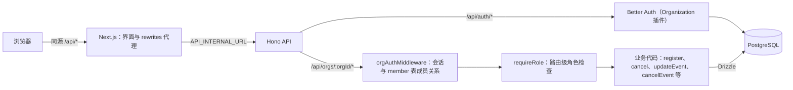
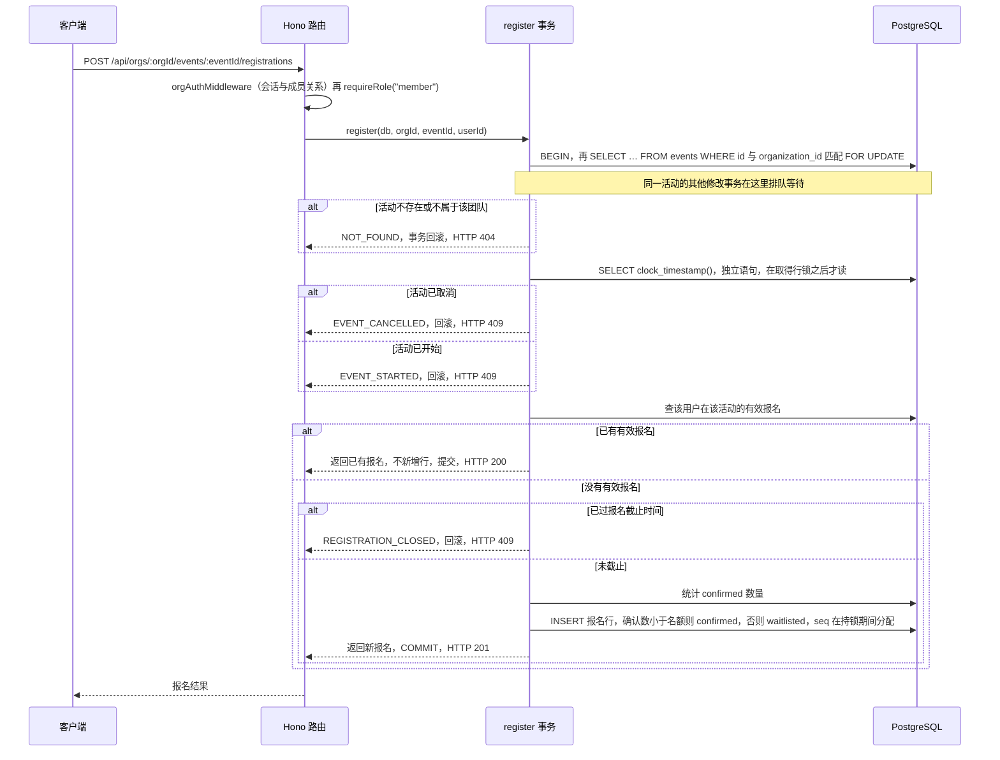

# 活动报名系统

团队管理员创建有名额限制的活动，成员报名，满员进候补；有人取消时，候补按先后顺序自动递补。每个团队的数据相互隔离。

这是一个一人、一周、TypeScript 全栈的求职作品项目。重点不在功能多，而在用可重复运行的测试证明下面两件事。

## 两个硬证据

1. **并发不超卖。** 50 个不同用户同时抢 10 个名额：数据库里 10 条确认、40 条候补，确认数超过名额为 0，同一用户重复有效报名为 0（测试 C1）。以数据库最终状态为准，不以 HTTP 返回值为准。
2. **组织隔离。** A 组织的用户读取、修改、报名 B 组织的活动，全部被拒绝，数据库不变（测试 I1–I7）。

证明范围，如实写在这里：

- 并发测试断言的是所有操作完成后的数据库最终状态，不是每一次提交之后的中间状态。"任何时刻都成立"是对设计的要求，依靠每个修改事务先锁活动行（同一活动的修改被串行化）和事务原子提交。本项目只说"最终状态验证 + 行锁串行化的设计"，不声称每次提交都被验证过。
- 并发与事务测试（C 系列）直接调用业务层函数，每个 worker 独占一条数据库连接，起跑前断言各连接的后端 pid 互不相同。HTTP 层的状态码映射由 A1、隔离测试 I1–I7 和 Playwright 覆盖。
- 数据库相关测试连接真实 PostgreSQL，不用 Mock。
- 开发过程中做过一次性的变异实验：删掉业务代码里的行锁后，C1 得到 47 条确认（名额只有 10）。这个实验记录在 [docs/DECISIONS.md](docs/DECISIONS.md)（DEV-S3-07、DEV-S4-05），没有在当前代码上重跑。

## 功能与技术栈

- 流程：注册、登录 → 创建团队，或被邀请加入团队 → 管理员创建活动 → 成员报名 → 取消并递补。
- 角色：owner、admin、member。权限矩阵见 [PRD.md](PRD.md) 第 4 节。
- 不做：支付、邮件通知、日历同步、图片上传、团队内部 Teams、AI 功能、候补超时确认、重复活动、导出、多语言。
- 技术栈：TypeScript、pnpm workspace、Next.js + React + Tailwind、Hono + Zod（`@hono/zod-openapi`，前端用 Hono RPC）、Better Auth（Organization 插件）、PostgreSQL + Drizzle ORM/Kit、Vite+（`vp`）、Playwright、GitHub Actions、Docker Compose。
- 目录：`apps/web`（界面）、`apps/api`（Hono 接口与业务层）、`packages/db`（Drizzle schema 与迁移）、`e2e`（Playwright）、`scripts`、`docs`。

## 快速开始

前置：Docker 与 Docker Compose。要在本机运行测试和演示数据脚本，还需要 Node.js 24.11.0 或更高版本，以及 pnpm 12.14.0（`package.json` 的 `packageManager` 字段）。

1. 把 [.env.example](.env.example) 复制为 `.env`，至少把 `POSTGRES_PASSWORD` 和 `BETTER_AUTH_SECRET` 两个占位值换成自己的值（密钥用任意足够长的随机串，CI 里用 `openssl rand -hex 32` 生成）。`POSTGRES_USER`、`POSTGRES_PASSWORD`、`POSTGRES_DB`、`POSTGRES_PORT`、`BETTER_AUTH_SECRET` 缺失或为空时，Compose 会报错终止。`.env` 不要提交。
2. 先单独构建 API 镜像，再起栈。`apps/web/Dockerfile` 以 `event-system-api:latest` 为基础镜像，CI 的 e2e 作业也是这个顺序：

   ```bash
   docker build -f apps/api/Dockerfile -t event-system-api:latest .
   docker compose up -d --build
   ```

3. 启动顺序：`postgres`（健康检查通过）→ `migrate`（一次性迁移，成功退出）→ `api`（健康检查访问 `/doc`）→ `web`。稍等几秒后访问 <http://localhost:3000>。请用 `localhost` 访问：Compose 里 `BETTER_AUTH_URL` 固定为 `http://localhost:3000`，`TRUSTED_ORIGINS` 允许 `localhost` 与 `127.0.0.1` 的 3000 端口。

端口都只绑定回环地址：web 为 `127.0.0.1:3000`，api 为 `127.0.0.1:3001`，postgres 为 `127.0.0.1:${POSTGRES_PORT}`（`.env.example` 里是 5433）。

停止：`docker compose down`。不加 `-v`，数据库卷会保留。

## 演示数据

先在仓库根目录执行 `pnpm install`，然后在栈已经运行时执行：

```bash
pnpm seed
```

- 脚本通过 HTTP 调用正在运行的栈（默认 `http://localhost:3000`，可用环境变量 `SEED_BASE_URL` 覆盖，只接受回环地址），创建 2 个团队、9 个用户、3 个活动：A 团队 3 名额的活动有 5 人报名（3 确认、2 候补），A 团队 50 名额的活动没有报名，B 团队 5 名额的活动有 1 人报名。账号与口令见 [scripts/seed.ts](scripts/seed.ts)，全部是虚构的本地演示数据。
- 数据已经存在时（第一个演示用户注册返回"已存在"），脚本输出 `Already seeded` 并以退出码 3 结束，不写数据；`pnpm` 会多打印一行 `ELIFECYCLE`，这不是故障。
- 脚本中途失败后再运行，会走同一条"已存在"路径，此时数据可能不完整，脚本没有回滚（外键是 RESTRICT）。需要从零开始时，删除 Compose 的数据库卷（会丢失全部数据）。
- Better Auth 对注册和登录有限流（同一 IP 10 秒内 3 次），遇到 429 时脚本最多重试 3 次。

## 测试与门禁

本地统一入口是 `pnpm gate`，依次运行：

1. `vp check`：格式、Lint、类型检查
2. `vp test`：单元测试
3. `pnpm test:integration`：集成测试，连真实 PostgreSQL
4. `pnpm test:concurrency`：并发测试，连真实 PostgreSQL
5. `pnpm --filter @event-system/db verify:migration`：空库迁移校验
6. `pnpm --filter @event-system/web build`：`next build`
7. `pnpm e2e`：Playwright

前提与注意：

- 需要一个可达的 PostgreSQL（例如 Compose 里的 `postgres`），并让 `DATABASE_URL` 对这些命令可见（值的形式见 [.env.example](.env.example)）。数据库不可达时 `pnpm gate` 直接失败，不会自动启动 Docker。集成与并发测试会在这个 PostgreSQL 里创建临时测试库。
- `pnpm e2e` 测的是**当前正在运行的栈**（默认 `http://localhost:3000`，可用 `E2E_BASE_URL` 覆盖），不会自己重建它。运行前确认栈是用当前代码新构建的。

只在 CI 里跑、不包含在 `pnpm gate` 里的检查：

- `docker-build`：分别构建 API 与 Web 镜像。
- 并发测试重复 5 次（`node scripts/repeat.mjs 5 -- pnpm test:concurrency`）。

CI 有 6 个作业：`ci`、`integration-tests`、`empty-db-migration`、`concurrency-tests`、`docker-build`、`e2e`。运行结果以 GitHub Actions 的记录为准，这里不写用例数量。

## C1 保留库演示

C1 默认在测试结束后删除临时库。设置环境变量 `KEEP_TEST_DB=1` 时保留它，并在测试输出里打印库名：

```bash
# bash
KEEP_TEST_DB=1 pnpm test:concurrency registrations.concurrency.test.ts
```

```powershell
# PowerShell
$env:KEEP_TEST_DB = "1"
pnpm test:concurrency registrations.concurrency.test.ts
```

然后用 `psql` 连接那个保留库（库名见测试输出），执行 [docs/demo/c1-final-state.sql](docs/demo/c1-final-state.sql)。脚本只读，列出 C1 活动各状态的报名数，并检查 INV-1、INV-2、INV-3 以及 `seq` 的相对关系，预期全部为真。它只证明最终状态，不证明中间状态。

保留库超过 1 小时会被下一次测试启动自动回收（来自代码阅读，回收行为本身没有验证过），所以请在同一次运行后 1 小时内查库。

## 架构

### 系统结构



- Next.js 只做界面，不处理认证逻辑；浏览器通过它的同源代理访问 `/api/*`，认证入口只在 Hono。
- 权限检查由自建中间件完成：查 `member` 表里（用户，`:orgId`）这一行及其角色，不依赖会话里的 `activeOrganizationId`。每个自建业务接口先过中间件，再进业务代码，每条查询都带 `organization_id`。
- `/api/auth/*` 是例外，由 Better Auth 自身的权限机制控制；其中的邀请和团队管理接口由测试 I6、I7 单独验收。
- 路由表 [apps/api/src/routes-table.ts](apps/api/src/routes-table.ts) 列出全部受保护的自建路由及最低角色，隔离测试对它做参数化，I5 检查它与 Hono 实际注册的路由一致。
- `registrations` 通过复合外键 `(event_id, organization_id)` 绑定到活动所属的团队。

### 报名事务



- 这张图照 `register` 的代码顺序画（见 `apps/api/src/registrations.ts` 与 `apps/api/src/event-tx.ts`）。业务层只返回领域结果或领域错误，HTTP 状态码由路由层映射。
- 报名、取消、改名额、递补遵守同一规则：事务内先锁活动行，再读时钟；业务时间判断用独立语句读取 `clock_timestamp()`，不用 `now()`，因为 `now()` 是事务开始时间，事务在行锁上等待之后它已经过期。
- 部分唯一索引 `UNIQUE (event_id, user_id) WHERE status IN ('confirmed','waitlisted')` 是"同一用户同一活动最多一条有效报名"（INV-3）的最后一道防线，不是主要手段。
- 递补按 `seq` 从小到大，在取消的同一个事务里完成，不跳人。

## 已知限制

下面每一条都来自开发记录 [docs/DECISIONS.md](docs/DECISIONS.md)（括号里是出处），或来自对代码的阅读。

- **没有公网部署。** 只在本机 HTTP 下验证过；Secure Cookie、HTTPS，以及真实域名下 `trustedOrigins` 的行为没有验证（[PRD.md](PRD.md) 第 10 节）。
- **并发证据的范围。** 如上文所述，测试验证最终状态，C 系列不经 HTTP。PRD 第 8 节的两项诊断（删掉 `FOR UPDATE` 后 C7 应变红；把 `clock_timestamp()` 换成 `now()` 后 C6 等锁交错用例应变红）最近一次是在 S4b 阶段做的（DEV-S4B-05 的 N1、N2），没有在当前代码上重跑。
- **报名名单接口不分页**，候补长度没有上限（DEV-S5-07）。
- **`requireRole` 对与 `Object.prototype` 同名的角色串（如 `constructor`）不会返回 403。** 只对判断表达式的副本做过实测，没有测中间件本身；目前没有发现能把这类角色串写入 `member.role` 的路径（DEV-S4B-03、DEV-S4B-05 第 13 项）。
- **限流可被伪造的 `x-forwarded-for` 绕过**，限流计数存在进程内存里，多副本部署时不共享（DEV-S6-03）。生产环境需要由反向代理统一重写该头。
- **I5 靠处理函数的参数个数区分中间件和路由处理器**：以 `(c, next)` 两个参数声明的路由处理器会被排除出比较。这是代码阅读得出的，没有做针对性的变异实验。
- **e2e 只测了 Chromium**，且不在分支保护的必需检查里（DEV-S6-07、DEV-S6-10）。前端页面除 E0–E3 之外，靠作者手工走通，没有自动化测试（DEV-S5-07）。
- **没有日志聚合与告警**，结构化日志只输出到 stdout（DEV-S6-01）。
- **容器与构建**：API 容器以 root 运行，Dockerfile 硬编码了 npm 镜像源（`registry.npmmirror.com`），`pnpm install` 没有加 `--prod`（按 Dockerfile 阅读得出，没有进入镜像核对）；GitHub Actions 使用可移动的主版本标签（如 `actions/checkout@v4`），没有固定到提交哈希（DEV-S4B-05 第 5 项、DEV-S6-07 第 16 项）。
- **`member` 表没有 `(organization_id, user_id)` 唯一约束。** 认证表由 Better Auth CLI 生成，按项目规则不改（DEV-S4B-05 第 6 项）。
- **`/api/auth/*` 的邀请与团队管理接口使用 Better Auth 默认权限**，只由 I6、I7 验证。更新团队信息、退出团队、取消邀请不做界面，也没有单独测试（PRD 第 4 节）。
- **没有邀请列表、重发、取消邀请的界面**：邀请链接丢失后无法在界面找回；同一邮箱已有待处理邀请时再次邀请会被后端拒绝（DEV-S5-04）。
- **测试数据清不掉。** e2e 与演示脚本创建的用户和团队留在开发库里：外键是 RESTRICT，不能直接删除用户或团队（DEV-S2-02、DEV-S3-01、DEV-S6-07 第 13 项）。

## 文档

- [PRD.md](PRD.md)：产品、业务规则、权限矩阵、事务契约和验收测试，是这个项目的唯一事实来源。
- [AGENTS.md](AGENTS.md)：开发过程中给执行代理的规则。
- [docs/DECISIONS.md](docs/DECISIONS.md)：技术决策、验证记录和更正记录。
- [docs/DEVELOPMENT_PLAN.md](docs/DEVELOPMENT_PLAN.md)：开发顺序与分工的记录，部分内容已过时，冲突时以 PRD.md 为准。

## 许可证

MIT，见 [LICENSE](LICENSE)。
